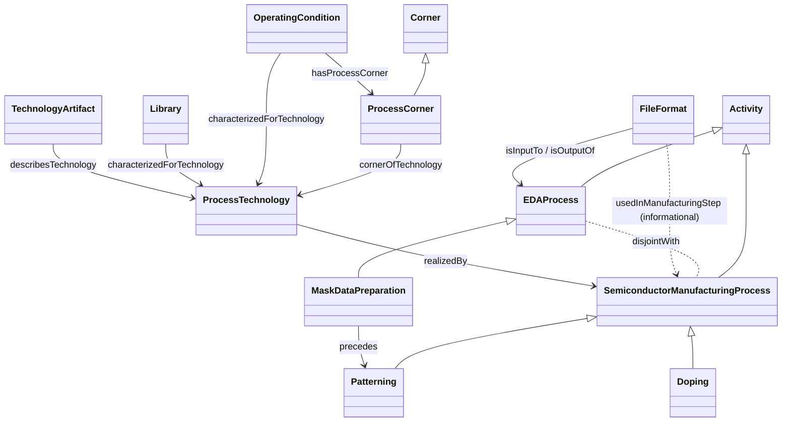

# "Process" in the EDA Ontology

This document explains how `eda_ontology.ttl` uses the word *process*. It covers
the issue reported against the earlier model, the changes made in version 2.1.0,
and how to migrate existing data and queries.

## 1. The reported issue

The ontology used "process" in five terms with overlapping, unclear meanings:

| Term | Kind | Parent / domain | Range |
|---|---|---|---|
| `eda:EDAProcess` | `owl:Class` | (root) | |
| `eda:SemiconductorManufacturingProcess` | `owl:Class` | subclass of `eda:EDAProcess` | |
| `eda:ProcessCorner` | `owl:Class` | subclass of `eda:Corner` | |
| `eda:process` | `owl:DatatypeProperty` | `eda:OperatingCondition` | `xsd:string` |
| `eda:processCorner` | `owl:DatatypeProperty` | `eda:OperatingCondition` | `xsd:string` |

The issue raised three problems:

1. **Computing and manufacturing processes were mixed together.** `eda:EDAProcess`
   is a computing process: it consumes design artifacts such as RTL.
   `eda:Doping` is a manufacturing process, yet it was a subclass of
   `eda:EDAProcess`. It was also unclear why a file format was used in a
   manufacturing step.
2. **No property linked an operating condition to a fabrication process.**
   There was no way to say which process a characterization corner belongs to.
3. **`eda:process` and `eda:processCorner` were redundant.** They had the same
   domain and range. `eda:processCorner` had no label or comment. They sat in
   different sections of the file, and neither was declared equivalent to the
   other.

## 2. Root cause: four meanings, two names

The ontology used "process" in four different senses but had dedicated terms for
only two of them:

| | Meaning | Example | Before 2.1.0 | From 2.1.0 |
|---|---|---|---|---|
| **A** | Computational design activity | Synthesis, Routing, OPC | `eda:EDAProcess` | `eda:EDAProcess` (redefined) |
| **B** | Physical fabrication step | Doping, Etching, CMP | `eda:SemiconductorManufacturingProcess`, wrongly under **A** | Same IRI, now a sibling of **A**, disjoint |
| **C** | Process technology: a foundry's named process or node (e.g. "N5") | | Strings only (`eda:nomProcess`, `eda:techNode`) | New class `eda:ProcessTechnology` |
| **D** | Variation point within a technology | TT, SS, FF | `eda:ProcessCorner`, plus two string properties | `eda:ProcessCorner`, linked with `eda:hasProcessCorner` |

The second problem in the issue is really about meaning **C**. A characterization
corner belongs to a *process technology*, not to an individual step such as
Doping. The missing link therefore targets the new `eda:ProcessTechnology` class,
not `eda:SemiconductorManufacturingProcess`.

## 3. Related defects found during analysis

Checking the reported problems uncovered four related defects. Each one blocked
or undermined a fix for the reported problems.

1. **Splitting the hierarchies alone would have broken the ontology.**
   `eda:isInputTo` is the inverse of `eda:consumes` and has range
   `eda:EDAProcess`. `eda:GDSIIFile` and `eda:OASISFile` asserted
   `eda:isInputTo eda:Patterning`. A restriction also required every GDSII file
   to be input to exactly one `eda:Patterning`. Through the range, any
   Patterning step that received a GDSII file was inferred to be an
   `eda:EDAProcess`. The range of `eda:usedInManufacturingStep` did the same to
   `eda:MetrologyAndInspection`. With the new disjointness axiom, these
   inferences would make `eda:GDSIIFile` unsatisfiable. They are also the source
   of the "file format used in a manufacturing step" confusion: a fabrication
   step uses masks, not files.
2. **Every corner was inferred to be an operating condition.**
   `eda:hasProcessCorner`, `eda:hasVoltageCorner` and `eda:hasTemperatureCorner`
   were subproperties of `eda:hasOperatingCondition`, which has range
   `eda:OperatingCondition`. A reasoner therefore inferred every corner reached
   through them to be an `eda:OperatingCondition`. This conflated the
   analysis-side *corner* with the library-side *characterization condition*.
3. **`eda:hasOperatingCondition` and `eda:hasRCCorner` were each declared
   twice,** the second time with domain `eda:TimingScenario`. Multiple
   `rdfs:domain` statements intersect: every `TimingScenario` that used either
   property was inferred to be an `AnalysisView` (and, for
   `hasOperatingCondition`, a `Library` or `AnalysisView`).
4. **`eda:process` merged two Liberty concepts.** Its label, "process corner
   factor/name", combined the numeric Liberty `process` derating multiplier with
   a corner name. The related `eda:nomProcess` (Liberty `nom_process`, also a
   number) was typed `xsd:string`.

## 4. The model from version 2.1.0



### 4.1 Separating computing and manufacturing processes

| Change | Detail |
|---|---|
| New class `eda:Activity` | Common parent of everything that unfolds in time. |
| `eda:EDAProcess` | IRI unchanged. Now a subclass of `eda:Activity`, redefined as a *computational* activity performed by EDA software on design data. |
| `eda:SemiconductorManufacturingProcess` | IRI unchanged. Moved from under `eda:EDAProcess` to under `eda:Activity`, and declared `owl:disjointWith eda:EDAProcess`. All 15 fabrication subclasses (Doping, Patterning, Etching, ...) move with it. |
| `eda:precedes`, `eda:hasSubProcess`, `eda:isPartOf` | Domain and range widened from `eda:EDAProcess` to `eda:Activity`, so fabrication flows can be sequenced and decomposed too. |
| `eda:consumes`, `eda:produces`, `eda:usesTool`, `eda:isInputTo`, `eda:isOutputOf` | Unchanged; they stay on `eda:EDAProcess`. Reading or writing design data with a tool is what defines a computing process. |

### 4.2 Design-to-manufacturing handoff

| Change | Detail |
|---|---|
| New class `eda:MaskDataPreparation` | A subclass of `eda:EDAProcess`: the computational step (fracturing, job-deck generation) that converts final layout into mask-writer data. It is the point where design hands off to manufacturing. |
| `eda:GDSIIFile`, `eda:OASISFile` | `eda:isInputTo eda:Patterning` replaced by `eda:isInputTo eda:MaskDataPreparation`. |
| GDSII restriction | "input to exactly one `eda:Patterning`" replaced by "input to some `eda:MaskDataPreparation`". |
| `eda:usedInManufacturingStep` | Kept, with a new comment: an *informational* link from a format to a fabrication step whose masks or recipes derive from that data. Unlike `isInputTo`, it does not claim the step reads the file. |

### 4.3 Process technology

| New term | Kind | Domain | Range |
|---|---|---|---|
| `eda:ProcessTechnology` | Class (disjoint with `eda:Activity`) | | |
| `eda:realizedBy` | Object property | `ProcessTechnology` | `SemiconductorManufacturingProcess` |
| `eda:cornerOfTechnology` | Object property | `ProcessCorner` | `ProcessTechnology` |
| `eda:characterizedForTechnology` | Object property | `OperatingCondition` ∪ `Library` | `ProcessTechnology` |
| `eda:describesTechnology` | Object property | `TechnologyArtifact` | `ProcessTechnology` |

`eda:techNode` now also applies to `eda:ProcessTechnology`; its domain is
`TechLEF` ∪ `ProcessTechnology`.

### 4.4 Process corner properties

| Term | Status | Notes |
|---|---|---|
| `eda:hasProcessCorner` | Changed | Domain widened to `AnalysisView` ∪ `OperatingCondition`. This is now the single way to attach a process corner. The corner name ("TT") is given with `eda:name` on the `eda:ProcessCorner` individual. |
| `eda:processFactor` | New | `OperatingCondition` → `xsd:double`: the numeric Liberty `process` derating factor. |
| `eda:nomProcess` | Changed | Range changed from `xsd:string` to `xsd:double` (Liberty `nom_process`). |
| `eda:process` | **Deprecated** | `owl:deprecated true`; `dct:isReplacedBy eda:processFactor, eda:hasProcessCorner`. |
| `eda:processCorner` | **Deprecated** | `owl:deprecated true`; `dct:isReplacedBy eda:hasProcessCorner`. Now has a label and comment. |

The deprecated properties remain declared for one release, so existing data still
loads. They will be removed in a later major version.

### 4.5 Corners and operating conditions

| Change | Detail |
|---|---|
| New `eda:hasCorner` | Parent property (range `eda:Corner`) of `hasRCCorner`, `hasLibCorner`, `hasProcessCorner`, `hasVoltageCorner` and `hasTemperatureCorner`. |
| Removed `rdfs:subPropertyOf eda:hasOperatingCondition` | From `hasProcessCorner`, `hasVoltageCorner` and `hasTemperatureCorner`. Corners are no longer inferred to be operating conditions. |
| `eda:hasOperatingCondition` | Merged into one declaration with domain `Library` ∪ `AnalysisView` ∪ `TimingScenario`. |
| `eda:hasRCCorner` | Merged into one declaration with domain `AnalysisView` ∪ `TimingScenario`. |

## 5. Migration

### 5.1 Data producers

Before:

```turtle
ex:oc_ss a eda:OperatingCondition ;
    eda:process "1.2" ;          # or "SS": a factor or a name, ambiguous
    eda:processCorner "SS" .
```

After:

```turtle
ex:n5    a eda:ProcessTechnology ; eda:techNode "5nm" .
ex:ss    a eda:ProcessCorner ; eda:name "SS" ; eda:cornerOfTechnology ex:n5 .
ex:oc_ss a eda:OperatingCondition ;
    eda:processFactor "1.2"^^xsd:double ;
    eda:hasProcessCorner ex:ss ;
    eda:characterizedForTechnology ex:n5 .
```

Other updates for data producers:

- Typing a fabrication step as both an `eda:EDAProcess` subclass and an
  `eda:SemiconductorManufacturingProcess` subclass now makes the data
  inconsistent.
- Do not use `eda:consumes` or `eda:isInputTo` with fabrication steps. Use
  `eda:usedInManufacturingStep` for informational links, and `eda:precedes` to
  sequence `eda:MaskDataPreparation` before `eda:Patterning`.
- Convert `eda:nomProcess` values to numbers.

### 5.2 Query consumers

- Queries of the form `?c rdfs:subClassOf* eda:EDAProcess` no longer return
  manufacturing classes. The transitive count drops from 47 to 32 (including
  `EDAProcess` itself): 16 manufacturing classes leave and
  `MaskDataPreparation` joins. To get both kinds, query `eda:Activity`.
- During the transition, read the corner name from both old and new forms:

```sparql
SELECT ?oc ?corner WHERE {
  { ?oc eda:hasProcessCorner/eda:name ?corner }
  UNION { ?oc eda:processCorner ?corner }
  UNION { ?oc eda:process ?corner
          FILTER(!regex(str(?corner), "^[0-9.eE+-]+$")) }   # skip numeric factors
}
```

## 6. Verification

`ontology/tests/test_process_terminology.py` (requires `owlrl`) runs OWL-RL
reasoning over the ontology plus small sample data, and checks that:

- no manufacturing class is asserted or inferred as an `eda:EDAProcess`, either
  as a subclass or through class-level property values;
- the ontology is consistent, and an individual typed as both a fabrication
  step and an EDA process is reported as a disjointness violation;
- GDSII and OASIS feed `eda:MaskDataPreparation`, not `eda:Patterning`;
- the process-technology links and the new corner model reason without
  clashes;
- `eda:process` and `eda:processCorner` are deprecated with replacements;
- a corner reached through `hasProcessCorner`, `hasVoltageCorner` or
  `hasTemperatureCorner` is not inferred to be an `eda:OperatingCondition`;
- `hasOperatingCondition` and `hasRCCorner` each have a single `rdfs:domain`.

Against the 2.0.0 file, 25 of these 27 tests fail. Against 2.1.0 all pass,
together with the existing `test_eda_ontology.py` suite.

## 7. Out of scope (follow-up candidates)

- **File-format modeling clash.** `eda:isInputTo` and `eda:isOutputOf` have domain
  `eda:FileFormat`, while `eda:GDSIIFile` is a subclass of `eda:GDSII`, which is
  a subclass of `eda:Layout`. `eda:FileFormat` is declared disjoint with
  `eda:Layout`. Any GDSII file *instance* that uses `isInputTo` is therefore
  inconsistent, in 2.0.0 and 2.1.0 alike. The format classes also attach
  `isInputTo` values at class level (OWL punning), which does not constrain
  instances.
- **Other properties with several `rdfs:domain` statements:** `slack`,
  `arrivalTime`, `requiredTime`, `maxCapacitance`, `maxTransition`, `instName`.
  `slack`, `arrivalTime` and `requiredTime` also have several `rdfs:range`
  statements.
- **Copies elsewhere.** The ontology copies under `usecases/drexel_ice/` are
  separate files and were not changed.
