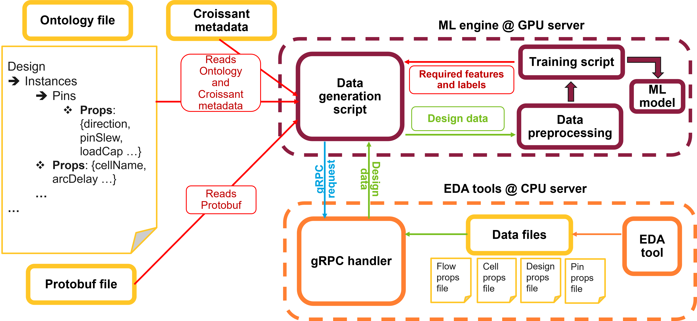

# ASU ML EDA Data Flow

This directory contains scripts and example usecases for generating ML-ready datasets using an ontology.

## Repository Structure

```
ASU_ML_EDA_data_flow/
├── designs/             # Sample design data in CircuitOps format and raw EDA files
├── src/                 # Data generation scripts
├── croissant/           # Croissant metadata mapping ontology properties to dataset columns
├── usecases/            # ML use cases demonstrating dataset consumption for model training
```

## Data Generation Flow

The diagram below illustrates how design data is converted into ML-ready datasets wiht the help of a standardized schema.



### Flow Components

1. **Ontology & Croissant Metadata**  
   - The ontology file defines hierarchical relationships between EDA components along with the properties associated with each entity.
   - The Croissant metadata (`croissant/circuitops_croissant_metadata_ontology.json`) provides a mapping between these schema-defined properties and the actual data sources (e.g., CSV files).

2. **Protobuf File**  
   - Specifies the gRPC message structure used for requesting data from a remote server.

3. **Data Generation Script**  
   - Central script that reads ontology and metadata files.
   - Accepts user-defined features and labels.
   - Sends gRPC requests (if needed) and merges retrieved data into a structured dataset.

4. **Data Files**  
   - Files containing EDA design attributes (e.g., pin, cell, design properties) produced by standard EDA tools.

6. **ML Pipeline**  
   - The dataset is fed into a preprocessing pipeline and subsequently used for ML model training.

### Flow Overview
- The ML training script specifies the required features and labels based on the application needs.
- It utilizes APIs from the data generation script to fetch the necessary dataset.
- The dataset is constructed by interpreting the ontology and croissant mapping files.


## Getting Started

Set up environment:
```bash
python -m venv venv
source venv/bin/activate
pip install -r requirements.txt
```
Run an example usecase:
```bash
cd usecases/ASU/ASU_ML_EDA_data_flow/usecases/arc_delay_predictor/
python3 arc_delay_prediction.py
```

See `src/README.md` for detailed explanation on script usage and `usecases/README.md` for explanations on ML examples.

## Modifying Flow
Refer to [guidelines for custom flow setup](./guidelines_to_customflow.md) to use this ML EDA data flow for custom applications.
